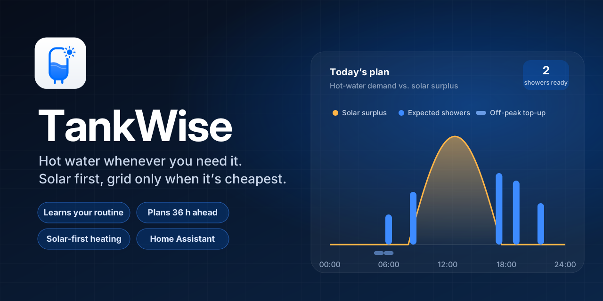

<p align="center">
  
</p>

# TankWise

[](https://github.com/jdgarcia99/ha-tankwise/actions/workflows/validate.yml)
[](https://github.com/jdgarcia99/ha-tankwise/actions/workflows/tests.yml)

*[Read in English](README.md)*

TankWise es una integración de Home Assistant que toma el control completo de
un termo eléctrico de acumulación gobernado por un regulador de potencia (por
ejemplo un FreeDS con PWM). Decide **cuándo y cuánto calentar** para que
siempre haya agua caliente cuando la casa la necesita, al mínimo coste (precio
PVPC de compra más el valor del excedente solar).

## Estado del proyecto

> **En desarrollo (0.5.0, fase 2 de 7).** TankWise aprende cómo se comporta
> el depósito, detecta cada extracción de agua caliente y prevé la demanda,
> pero **todavía no actúa sobre ningún dispositivo**. Mantén tus
> automatizaciones hasta la fase 4.

| Fase | Contenido | Estado |
|------|-----------|--------|
| 1 | Modelo térmico, detección de extracciones, importación del histórico, sensores (sin actuar) | ✅ Hecha |
| 2 | Perfil de demanda y previsión, citas de agua caliente | ✅ Hecha |
| 3 | Precios, valor del excedente y optimizador; modo Sombra con el plan | Prevista |
| 4 | Controlador, seguridades y modo degradado; modo Auto | Prevista |
| 5 | Boost con blueprint para pulsadores externos | Prevista |
| 6 | Previsión solar, coordinación con SolarSplit y antilegionela | Prevista |
| 7 | Migración desde las automatizaciones y documentación completa | Prevista |

## Instalación

1. En HACS, abre el menú y elige **Repositorios personalizados**.
2. Añade `https://github.com/jdgarcia99/ha-tankwise` con la categoría **Integración**.
3. Instala **TankWise** y reinicia Home Assistant.
4. Ve a **Ajustes → Dispositivos y servicios → Añadir integración → TankWise**.

## Configuración

Todo se configura desde la interfaz; no hay nada en `configuration.yaml` y
ningún `entity_id` está fijado en el código.

**Entradas obligatorias**

- Temperatura del depósito: sonda en la parte alta (°C o °F).
- Potencia del termo (W o kW).
- Interruptor de alimentación del termo (debe estar siempre encendido).
- Modo manual del regulador: interruptor que hace que caliente a plena
  potencia (p. ej. el modo manual de FreeDS).
- Precio de compra de la electricidad (p. ej. PVPC).

**Entradas recomendadas y opcionales**

- Energía del termo (kWh o Wh, `total_increasing` o `total`). Recomendada;
  sin ella se integra la potencia.
- Salida del regulador (%), p. ej. la salida PWM de FreeDS.
- Entidad que indica si el regulador es maestro del termo.
- Casa ocupada.
- Precio de inyección, energía importada y exportada, potencia exportada ahora.
- Previsión solar (Forecast.Solar o Solcast).
- Temperatura ambiente donde está el termo.
- Sensor de días laborables (integración Workday): los festivos se aprenden
  aparte y las citas se pueden fijar para laborables o festivos.

**Opciones**

El menú de opciones tiene tres partes: parámetros de la instalación, entradas
y citas de agua caliente. Los parámetros solo muestran el volumen del depósito
y la región del agua de red; lo que TankWise aprende solo queda plegado en
**Opciones avanzadas**:

| Parámetro | Valor por defecto |
|-----------|-------------------|
| Volumen | 100 L |
| Región del agua de red | Islas Baleares |
| *Avanzada:* potencia de calentamiento (valor inicial, después se aprende) | 1500 W |
| *Avanzada:* temperatura ambiente sin sensor | 20 °C |
| *Avanzada:* temperatura de corte del termostato (valor inicial, después se aprende) | 68 °C |
| *Avanzada:* umbral de potencia de corte del termostato | 50 W |
| *Avanzada:* agrupar los días del perfil de uso | Laborables y fines de semana/festivos |
| *Avanzada:* días de cada tipo en el perfil de uso | 16 |

**Ajustes (entidades number)**

| Entidad | Valor por defecto |
|---------|-------------------|
| Temperatura de ducha | 40 °C |
| Temperatura mínima de confort | 38 °C |
| Temperatura del agua de red | 0 = automática (tabla mensual de la región, interpolada día a día) |

Las instalaciones que vienen de la 0.2 se migran solas y conservan lo
aprendido. Un aviso de reparación pide completar las nuevas entradas
obligatorias con **Reconfigurar**.

## Citas de agua caliente

Una cita dice "agua caliente lista a esta hora, con al menos esta cantidad
para el bloque que sigue": nombre, hora de inicio, duración del bloque (1 hora
por defecto, p. ej. 3 horas para las duchas de la tarde), días de la semana (o
laborables/festivos con el sensor Workday), litros mínimos a la temperatura de
ducha y si está activa. Los litros mínimos deben estar disponibles al empezar
el bloque y cubrirlo entero sin recalentar. Hasta seis, ninguna
por defecto. Se añaden en **Opciones → Citas de agua caliente**.

Cada cita tiene entidades para ajustarla desde un panel (los cambios se
guardan en las opciones): `time.<nombre>_<cita>_time`,
`number.<nombre>_<cita>_liters` y `switch.<nombre>_<cita>_enabled`. El sensor
`sensor.<nombre>_<cita>_suggested_liters` muestra los litros que realmente se
usan durante el bloque (P90 de las últimas cuatro semanas) para
ayudar a elegir el mínimo, y `sensor.<nombre>_<cita>_required_temperature` la
temperatura que necesita el depósito al empezar el bloque. Si supera el corte
aprendido del termostato, `binary_sensor.tankwise_plan_at_risk` se enciende:
ni el depósito lleno cubre el bloque. Desde la fase 3 el planificador trata
cada cita activa como una restricción obligatoria sobre los litros útiles.

## Entidades

Los `entity_id` se generan en inglés a partir del nombre de la instancia (por
ejemplo `sensor.<nombre>_available_liters`) sea cual sea el idioma; los
nombres visibles están traducidos.

| Entidad | Descripción |
|---------|-------------|
| Energía almacenada | kWh almacenados por encima de la temperatura del agua de red |
| Energía útil | kWh almacenados por encima de la temperatura mínima de confort |
| Carga | Energía útil en porcentaje de un depósito lleno |
| Agua caliente disponible | Litros útiles a la temperatura de ducha antes de que el agua baje de la temperatura de confort (litros teóricos como atributo) |
| Plan en riesgo (binario) | Encendido cuando una cita activa necesita más de lo que da el depósito lleno |
| Temperatura modelada | Temperatura equivalente del depósito según el modelo |
| Estado del modelo | `calibrated`, `learning` o `uncertain` |
| Última extracción | Inicio de la última extracción, con su energía, temperatura mínima y si hubo falta de agua |
| Faltas de agua caliente (7 días) | Extracciones que dejaron el agua al menos 1,5 °C por debajo de la temperatura mínima de confort |
| Demanda de agua caliente hoy | Energía que necesita un día fuerte (P90), con el día habitual (P50) y el resto de hoy como atributos |
| Previsión de demanda de agua caliente | Demanda de las próximas 36 horas (P90), con las franjas de 15 minutos como atributo |
| Coeficiente de pérdidas (diagnóstico, desactivado por defecto) | UA aprendido, en W/K |
| Potencia de calentamiento aprendida (diagnóstico, desactivado por defecto) | Potencia media de la resistencia a plena potencia |
| Temperatura de corte del termostato (diagnóstico, desactivado por defecto) | Mediana de los últimos 20 cortes |
| Factor de capacidad efectiva (diagnóstico, desactivado por defecto) | Parte de la energía de calentamiento que ve la sonda |
| Temperatura del agua de red (diagnóstico) | Valor en uso y su origen |

El diagnóstico incluye los parámetros aprendidos, el resultado de la
importación del histórico, los días observados del perfil de uso y las
últimas 50 extracciones.

## Servicios

| Servicio | Descripción |
|----------|-------------|
| `tankwise.reset_learning` | Olvida las pérdidas de calor (`part: losses`), el perfil de uso (`part: demand`) o todo (`part: all`, por defecto). `config_entry_id` opcional. |

## Cómo funciona el modelo del depósito

- **Energía y litros.** `C = V · 0,001163` kWh/K. Energía almacenada
  `E = C · (T − T_red)`. El agua fría que entra se mezcla con la caliente, así
  que solo se aprovecha el calor por encima de la temperatura de confort:
  litros útiles a la temperatura de ducha
  `L = k_use · V · (T − T_confort) / (T_ducha − T_red)`, con `k_use` aprendido
  de las faltas reales.
- **Pérdidas.** `P = UA · (T − T_ambiente)`. UA se aprende por mínimos
  cuadrados recursivos con la pendiente de la sonda en ventanas de reposo de
  al menos dos horas (sin calentar ni extracciones), entre 0,3 y 3 W/K.
- **Capacidad efectiva.** La sonda está arriba y no ve toda la energía. El
  factor `k_cap` (0,9 al principio) se aprende comparando la energía de
  calentamiento con la subida de la sonda en calentamientos sin extracciones.
- **Potencia y termostato.** La potencia real de la resistencia se aprende del
  sensor de potencia. Un corte del termostato se detecta cuando el regulador
  pide potencia (modo manual encendido o PWM por encima del 10 %) y la
  potencia se queda por debajo de 50 W durante 3 minutos; ese instante se toma
  de los cambios de estado, así que una automatización que apague el modo
  manual después no lo oculta.
- **Extracciones.** Cada minuto se compara el cambio observado de la sonda
  filtrada con el previsto. Una extracción empieza cuando el residuo acumulado
  en 10 minutos baja de −1 °C y termina cuando se mantiene cerca de cero
  durante 5 minutos. Su energía es `C · ΔT_residual / k_cap`.
- **Perfil de uso.** Cada día completo (al menos 20 h observadas, casa
  ocupada) se guarda como la energía extraída en sus 96 franjas de 15
  minutos. La previsión usa los últimos 16 días del mismo tipo, con más peso
  los recientes (semivida de tres semanas). Los percentiles se calculan sobre
  la curva acumulada de cada día, no franja a franja: la P90 de un día es un
  día "fuerte", y las duchas que se mueven 15–30 minutos no cuentan dos
  veces. Una extracción que dejó el agua por debajo de la temperatura de
  confort sube un 20 % la previsión de esa hora durante dos semanas. Con la
  casa vacía la previsión es cero.
- **Reconciliación energética.** La sonda de arriba ve una ducha tarde y
  pequeña mientras el agua fría se queda abajo, y demasiado grande cuando el
  frente frío llega a ella. Tras cada calentamiento el depósito está mezclado,
  así que el balance de energía entre dos calentamientos asentados da la
  energía realmente extraída y las extracciones intermedias se ajustan a ella.
  Una bajada de más de 1 °C sobre las pérdidas en una hora en reposo se
  registra como extracción lenta.
- **Falta de agua caliente.** Una extracción que llevó la sonda al menos
  1,5 °C por debajo de la temperatura mínima de confort.
- **Importación del histórico.** En el primer arranque se reproducen los
  últimos 10 días del recorder a través de los modelos, así que pérdidas,
  cortes, extracciones y el perfil de uso se conocen desde el primer día.
- **Modo seguro.** Sin sonda o sin potencia el modelo se congela y los
  sensores del depósito quedan no disponibles; no se inventa nada. Tras una
  interrupción de más de 30 minutos el estado es incierto hasta el siguiente
  llenado.

## Desarrollo

```bash
uv venv --python 3.14 .venv
uv pip install --python .venv/bin/python -r requirements_test.txt
.venv/bin/pytest
```

Los modelos de `custom_components/tankwise/model/` son Python puro y no
importan Home Assistant.

### Exportar el histórico para el banco de simulación

`tools/export_history.py` descarga el histórico de las entradas mediante la
API REST de Home Assistant a `tests/fixtures/` (excluido de git). La URL y un
token de acceso de larga duración se leen de las variables de entorno
`HA_URL` y `HA_TOKEN` o de un fichero `.env` (también excluido de git):

```bash
export HA_URL=http://homeassistant.local:8123
export HA_TOKEN=...
python tools/export_history.py --start 2026-11-07 --end 2026-11-20 \
  --entity temperature=sensor.mi_termo_temperatura \
  --entity power=sensor.mi_termo_potencia
```

`python tools/export_history.py --help` muestra todos los roles.

## Licencia

[MIT](LICENSE)
