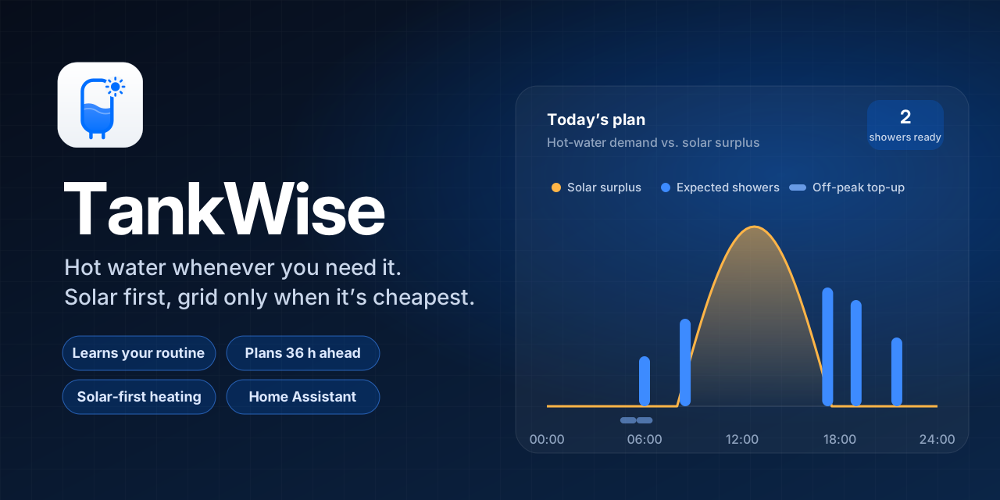

<p align="center">
  
</p>

# TankWise

[](https://github.com/jdgarcia99/ha-tankwise/actions/workflows/validate.yml)
[](https://github.com/jdgarcia99/ha-tankwise/actions/workflows/tests.yml)

*[Leer en español](README.es.md)*

TankWise is a Home Assistant integration that takes full control of an
electric storage water heater driven by a power regulator (for example a
FreeDS PWM diverter). It decides **when and how much to heat** so there is
always hot water when the household needs it, at the lowest cost (PVPC
purchase price plus the value of the solar surplus).

## Project status

> **0.10.0: all seven phases done.** TankWise learns the tank and the
> household's usage, computes the heating plan and, in the auto, eco, comfort
> and holiday modes, **controls the regulator** with its safeties. It starts
> in shadow mode (publishes the plan without acting): follow the
> [migration guide](docs/migration.md) to move from your automations.

| Phase | Content | Status |
|-------|---------|--------|
| 1 | Thermal model, draw detection, history import, sensors (no control) | ✅ Done |
| 2 | Demand profile and forecast, hot water appointments | ✅ Done |
| 3 | Prices, surplus value and optimiser; shadow mode with the plan | ✅ Done |
| 4 | Controller, safeties and degraded mode; automatic mode | ✅ Done |
| 5 | Boost with a blueprint for external push buttons | ✅ Done |
| 6 | Solar forecast, SolarSplit coordination and anti-legionella cycle | ✅ Done |
| 7 | Migration from automations and full documentation | ✅ Done |

## Installation

1. In HACS, open the menu and choose **Custom repositories**.
2. Add `https://github.com/jdgarcia99/ha-tankwise` with category **Integration**.
3. Install **TankWise** and restart Home Assistant.
4. Go to **Settings → Devices & services → Add integration → TankWise**.

## Configuration

Everything is configured from the UI; nothing goes into `configuration.yaml`
and no entity ID is fixed in the code.

**Required inputs**

- Tank temperature probe (°C or °F). Say where it is in **Options → Parameters → Probe position**: at the top of the tank (it sees the water leaving), or in the thermostat's sheath, low in the tank next to the element (common in DIY installations: a thermocouple slid into the sheath). In the sheath the probe stays hot during the first litres of a draw and then falls quickly when the cold front reaches it, long before the hot water at the top runs out. It still bounds the model: the mean is never taken below the *Volume below the probe* (30 %) at the mains temperature and the rest at the probe's.
- Water heater power (W or kW).
- Water heater power switch (it must always stay on).
- Regulator manual mode: switch that makes the regulator heat at full power
  (e.g. the FreeDS manual mode).
- Electricity purchase price (e.g. PVPC).

**Recommended and optional inputs**

- Water heater energy (kWh or Wh, `total_increasing` or `total`).
  Recommended; without it the power is integrated.
- Regulator output (%), e.g. the FreeDS PWM output.
- Entity that tells whether the regulator is master of the water heater.
- Home occupied.
- Grid injection price, grid import and export energy, current export power.
- Solar production forecast: one or more Forecast.Solar, Solcast or
  Open-Meteo Solar Forecast entries (summed).
- Regulator output switch (e.g. FreeDS "PWM enabled"), to sell the surplus.
- Regulator health: its mode (with the modes that heat, Auto and Manual by
  default), its uptime and its last restart reason. A power drop while the
  regulator is unavailable, restarting, in another mode or at 0 % is then not
  taken as a thermostat cut-off.
- Ambient temperature where the tank is.
- Workday sensor (Workday integration): holidays are learned apart and
  appointments can be set for workdays or holidays.
- Hot water meter at the outlet of the tank: cumulative volume (L or m³;
  `total_increasing`, `total` or no state class, as pulse counters publish
  it) and, optionally, its flow rate. With it the draws are measured in
  litres instead of estimated from the probe (see below).

**Options**

The options menu has three parts: installation parameters, inputs and hot
water appointments. The parameters show only the tank volume and the mains
water region; everything TankWise learns by itself is folded under
**Advanced options**:

| Parameter | Default |
|-----------|---------|
| Volume | 100 L |
| Mains water region | Balearic Islands |
| *Advanced:* heating power (initial value, then learned) | 1500 W |
| *Advanced:* ambient temperature without sensor | 20 °C |
| *Advanced:* thermostat cut-off temperature (initial value, then learned) | 68 °C |
| *Advanced:* thermostat cut-off power threshold | 50 W |
| *Advanced:* group days of the usage profile | Workdays and weekends/holidays |
| *Advanced:* days of each type in the usage profile | 16 |

**Settings (number entities)**

| Entity | Default |
|--------|---------|
| Shower temperature | 40 °C |
| Minimum comfort temperature | 38 °C |
| Mains water temperature | 0 = automatic (monthly table of the region, interpolated day by day) |

Entities that come from a 0.2 installation are migrated automatically and
keep what was learned. A repair issue asks you to complete the new required
inputs with **Reconfigure**.

## Hot water appointments

An appointment says "hot water ready by this time, with at least this much
water for the block that follows": name, start time, block duration (1 hour
by default, e.g. 3 hours for the evening showers), days of the week (or
workdays/holidays with the Workday sensor), minimum litres at the shower
temperature and active or not. The minimum litres must be available when the
block starts and cover the whole block without reheating. Up to
six, none by default. They are added in **Options → Hot water appointments**.

Each appointment gets entities to adjust it from a dashboard (changes are
saved in the options): `time.<name>_<appointment>_time`,
`number.<name>_<appointment>_liters` and `switch.<name>_<appointment>_enabled`.
The sensor `sensor.<name>_<appointment>_suggested_liters` shows the litres
actually used during the block (P90 of the last four weeks, raised like the
plan after recent shortages, at the shower temperature) to help choosing the
minimum. With a hot water meter the suggestion comes from the measured draws:
each is worth `litres_tank · (T_tank − T_mains) / (T_shower − T_mains)` litres
at the shower temperature, with the tank temperature when it started
(attributes `shower_liters_p50` and `shower_liters_p90`, and `source`);
`hot_liters_p50` and `hot_liters_p90` give the litres that really left the
tank. And `sensor.<name>_<appointment>_required_temperature`
the tank temperature needed when the block starts. If that temperature is
above the learned thermostat cut-off, `binary_sensor.tankwise_plan_at_risk`
turns on: even a full tank does not cover the block. From phase 3 the planner
treats every active appointment as a hard constraint on useful litres.

## Entities

Entity IDs are generated in English from the name of the instance (for
example `sensor.<name>_available_liters`) whatever the language; visible names
are translated.

| Entity | Description |
|--------|-------------|
| Stored energy | kWh stored above the mains water temperature |
| Useful energy | kWh stored above the minimum comfort temperature |
| Charge | Useful energy as a percentage of a full tank |
| Hot water available | Useful litres at the shower temperature before the water runs below the comfort temperature; in a stratified tank, `k_use` times the energy above the mains water (attributes: theoretical litres, `stratified`, `useful_floor_temperature`) |
| Maintenance in progress (binary) | On during a maintenance window (see [Maintenance window](#maintenance-window)); attributes `source`, `until` and `devices` |
| Plan at risk (binary) | On when hot water cannot be guaranteed: an appointment needs more than a full tank gives, the usual demand is not covered, or the regulator or the probe is unavailable before an appointment (`reasons` attribute) |
| Modelled temperature | Equivalent (mixed) tank temperature tracked by the model: the stored energy as a temperature |
| Estimated outlet temperature | Temperature of the hot layer at the outlet. With the probe at the top, what it sees: the modelled temperature plus the expected stratification. With the probe in the thermostat's sheath, the temperature of the last full charge less the losses (draws do not lower it while hot water remains) |
| Model status | `calibrated`, `learning` or `uncertain`; attributes `reason`, `missing` (what is needed to calibrate) and the `samples` of each learned parameter |
| Last draw | Start of the last hot water draw, with its energy, litres (with a hot water meter), minimum temperature and whether there was a shortage |
| Hot water shortages (7 days) | Draws that took the water at least 1.5 °C below the minimum comfort temperature |
| Hot water demand today | What was drawn today plus what a strong rest of the day needs (P90); attributes: the usual day (P50), what was drawn (`observed`, `observed_liters`), the rest of today and the whole day of the profile (`profile_p50`/`profile_p90`, and in litres with a meter) |
| Hot water demand forecast | Demand of the next 36 hours (P90), with the 15-minute slots as an attribute |
| Heat loss coefficient (diagnostic, disabled by default) | Learned UA, in W/K |
| Learned heating power (diagnostic, disabled by default) | Mean power of the heating element at full output |
| Thermostat cut-off temperature (diagnostic, disabled by default) | Median of the last 20 cut-offs |
| Effective capacity factor (diagnostic, disabled by default) | Share of the heating energy seen by the probe |
| Mains water temperature (diagnostic) | Value in use and its source |

The diagnostics include the learned parameters, the history import result,
the observed days of the usage profile and the last 50 draws.

## Heating plan

Every 15 minutes, and whenever something relevant changes, TankWise computes
the cheapest heating plan for the next 36 hours: how much grid energy to put
in each slot and whether to take the solar surplus or let it go to the grid
(when the injection price pays more than heating at night costs). Every
appointment must start with enough useful litres for its whole block; the
rest of the demand is covered slot by slot plus a reserve. A small stray draw
(less than the reserve before a cheaper hour, such as a late tap at night)
does not make the plan heat at an expensive hour. Grid heating runs last two
hours at most. When the plan is at risk, the `risks` attribute of
`sensor.tankwise_plan` says where (start, end), why (`appointment` or
`demand`) and how many litres are missing.

**Rescue recharge** (option, on by default): if an appointment block needs
more than a full tank, the tank is filled before the block and, inside the
block, only the energy missing to cover the usual demand left in it is
heated, never after the block. Rescues are logged and counted per month
(kWh and €). The plan at risk turns on only when not even the rescue covers
the appointment. With the option off (strict mode) nothing is heated inside
a block.

| Mode | Behaviour |
|------|-----------|
| Auto | Usual demand of a strong day (P90) |
| Eco | Usual demand of a normal day (P50): cheaper, more risk |
| Comfort | P90 plus 20 % |
| Holiday | No grid heating, solar surplus only |
| Shadow (default) | Publishes the plan without acting |
| Off | No plan, no action |

In shadow mode compare **Planned cost** with **Water heater cost** (real) and
look at the logbook: external orders on the regulator manual mode that
contradict the plan are logged there.

| Entity | Description |
|--------|-------------|
| Heating plan | Cost of the plan for the next 36 hours, with its grid heatings and appointment blocks as attributes. The slot by slot plan is too big for a state attribute: it is in the diagnostics and the `tankwise.get_plan` service |
| Next heating | Start of the next grid heating, with its duration, energy and cost |
| `<appointment>` predicted temperature | Temperature the plan expects when the block starts |
| Water heater cost today / this month | Real cost: grid at the purchase price, surplus at its value |
| Planned cost today / this month | What the plan spends |
| Estimated savings this month | Real cost minus planned cost |
| Rescue recharges energy / cost this month | kWh and € of rescue recharges |
| Surplus compensation / energy term this period, compensation cap margin | Automatic compensation cap (see below) |
| Planned grid heating (binary) | The current slot of the plan heats from the grid |
| Mode (select), hot water reserve and surplus value (numbers), compensation cap reached (switch), replan (button) | Settings |

## Control and safeties

In the auto, eco, comfort and holiday modes TankWise puts the regulator in
manual mode (full power from the grid) during the planned minutes of each
slot and back to automatic (surplus only) afterwards. Every order is written
to the logbook with its reason. Orders are sent when the plan changes its
mind (and repeated if they do not take effect), so an external order is
respected until the next change; the safeties still apply to it.

| Situation | Action |
|-----------|--------|
| Tank above the safety maximum (number, 72 °C) for 1 minute in manual mode | Back to automatic; no grid heating until the tank cools 3 °C |
| No power for 3 minutes in manual mode | Thermostat cut-off: back to automatic, same pause |
| More than 2 hours in a row in manual mode | Back to automatic for 15 minutes |
| Probe unavailable or not updated for 10 minutes | Back to automatic, degraded mode, no grid heating |
| Regulator unavailable beyond a margin (2 minutes, advanced option) while TankWise has it in manual mode, or while the element heats outside the plan | The heater switch is opened as a last resort; when the regulator returns it is set to automatic and the heater switch is closed again. A repair issue appears if this happens three times in a week |
| Heater switch off (not by TankWise) | No action; repair issue |
| Other enabled automations switch the regulator manual mode, its output or the heater switch | Repair issue listing them (they would fight the controller) |
| Mode changed to shadow or off | The regulator is given back in automatic if TankWise had it in manual mode |

**Degraded mode** (binary sensor): without a plan (no prices, or the tank
model is not ready) TankWise follows a simple rule. Before each active
appointment it heats up to the temperature the appointment needs (limited to
the learned thermostat cut-off), starting as early as the learned power
requires. Only when there are no active appointments it uses two fixed
windows: up to 50 °C between 04:00 and 06:15 and up to the thermostat
cut-off between 15:00 and 16:00. The safeties are the same.

When the plan turns at risk for a new reason TankWise fires the
`tankwise_plan_at_risk` event (`reasons`, `new_reasons`, `appointments`), for
example to send a notification when the regulator is unavailable before an
appointment that depends on a planned heating.


### Maintenance window

Firmware updates of ESPHome devices (or any restart) leave the probe, the
power meter or the regulator without data for a few minutes, or with values
that do not describe the tank. During a **maintenance window** TankWise keeps
its plan and its safeties, but:

- learns nothing: heater power, heat losses, capacity factor, usable factor,
  stratification, thermostat cut-offs and the demand profile (the window is
  not covered time, and the draws detected in it are not learned);
- counts nothing against the plan: no replan for a deviation or a draw (so no
  rescue recharge), no external order or deviation from a regulator that
  restarts, no hot water shortage, and a safety cut does not count towards
  the repeated cuts repair issue;
- does not enter degraded mode, nor puts the plan at risk, just because the
  probe or the regulator are missing; it still does when the plan is really
  at risk (an appointment or the demand it cannot cover, or an appointment
  within the hour).

A window opens while the **maintenance entity** (inputs options: a script,
input boolean, binary sensor or switch; a script is on while it runs, e.g.
the one that updates every ESPHome device) is on, and lasts the **margin
after maintenance** (10 minutes by default) once it goes off, because devices
reboot after their update. Without an entity it also opens automatically
when a device of the inputs (probe, power, energy, switches, regulator, hot
water meter) becomes unavailable, while it is unavailable up to 15 minutes
and for the margin after it returns, or restarts (its uptime sensor, found on
the same device, goes back: seconds since boot that fall, or a boot time
that moves later), for the margin after. An outage longer than 15 minutes is
a real outage: the usual rules for unavailable inputs apply. The binary
sensor **Maintenance in progress** shows the window (`source`: `entity`,
`unavailable` or `restart`; `until`; `devices`), and the heating plan sensor
its cause (`maintenance` attribute).

## Boost

A boost means "I want hot water now", whatever the reason: guests, a bath,
a heavy day. The regulator goes to manual mode at once, whatever the plan or
the price, in every mode except off (also shadow and holiday). It ends at the
**boost target** (number, 60 °C), at the thermostat cut-off, after the
optional **maximum duration** (number, 90 minutes, 0 for no limit), when a
safety stops the heating, or when it is cancelled. The safeties are never
skipped. Afterwards the plan is computed again with the energy already
stored. If the water is already above the target, nothing happens and the
logbook says so.

| Entity / service | Description |
|------------------|-------------|
| Boost (button) | Starts a boost; pressed while it runs, cancels it (one push button does both) |
| Cancel boost (button) | Cancels the boost |
| Boost active (binary) | With the start, target, expected end, maximum end, energy and cost |
| Boost target, boost maximum duration (numbers) | Defaults of the button |
| `tankwise.boost` | Optional `temperature` or `liters` (litres at the shower temperature that must be available) and `duration` (minutes) |
| `tankwise.cancel_boost` | Cancels the boost |

Events `tankwise_boost_started` and `tankwise_boost_finished` (with `reason`:
`target`, `thermostat`, `duration`, `safety` or `cancelled`, energy and cost)
can drive notifications or dashboards.

By default a boost does not change the usage profile, because its reason can
be anything; the draws after it are learned as usual. The option **Count a
boost as a hot water shortage** raises the forecast around the time of each
boost, like after a shortage.

### Push buttons

Any device can start a boost with an automation that presses
`button.tankwise_boost` or calls `tankwise.boost`. The
[`boost_from_button.yaml`](blueprints/automation/tankwise/boost_from_button.yaml)
blueprint does it without writing YAML: choose the trigger (a device trigger
of a ZHA, Zigbee2MQTT, Z-Wave or Shelly button, an event...), the action
(toggle, start only or cancel only) and optionally a temperature and a
duration. Import it from **Settings → Automations & scenes → Blueprints →
Import blueprint** with its GitHub URL.

## Solar surplus and anti-legionella

**Solar forecast.** Choose one or more forecast entries in the inputs
(Forecast.Solar, Solcast or Open-Meteo Solar Forecast: the same hourly
forecast the Energy dashboard uses; several entries, e.g. one per roof
plane, are summed). The plan counts on the expected surplus: the forecast
minus what the house uses at each hour. That part is learned for each hour
of the day from the grid export and from what the water heater took from
the surplus, so it also corrects the bias of the forecast. Until an hour is
learned, 0.25 kWh of house consumption is assumed.

**Automatic compensation cap.** With simplified compensation (Spain, PVPC)
the surplus of a billing period is paid at the injection price of each hour,
but never more than the energy term of that period's bill. With the grid
import and export energy sensors and the injection price among the inputs,
TankWise adds up, hour by hour, the compensation (export × injection price)
and the energy term (import × purchase price) of the billing period, and
projects both to its end with the hourly rate of the last 14 days. When the
projected compensation exceeds the projected energy term, that excess would
be exported for nothing: the plan takes that much surplus for free (the
first slots with expected surplus, value 0, until it covers the excess at
their injection price) and values the rest at the injection price as usual.
The past hours of the period come from the recorder statistics at every
start. The **Surplus compensation this period**, **Energy term this period**
and **Compensation cap margin** sensors (projected energy term minus
projected compensation; negative: over the cap) show it, with the projection,
the margin so far and the surplus over the cap as attributes. The period
starts on the **Billing period start day** (advanced parameter, 1: the
calendar month). The **Surplus compensation cap reached** switch still
forces the cap by hand (all the surplus free).

The energy term is estimated with the purchase price sensor as it is. The
PVPC (REE indicator 1001) includes the access tolls and charges of the
energy term, which cannot be separated from it. If your bill caps the
compensation at the energy term without them, set the advanced parameter
**Energy term factor for the compensation cap** (1.0 by default), which
multiplies the computed energy term. To calibrate it with a bill:

1. Take the energy term of a bill (the amount the compensation is limited
   to), and its billing period.
2. Over that same period, read the **Energy term without the factor**
   attribute of the **Energy term this period** sensor (on its last day; or
   with the factor at 1.0, the sensor itself).
3. Factor = energy term of the bill ÷ that value. For example 38.20 € ÷
   54.60 € = 0.70.

**Selling the surplus.** With the regulator output switch (FreeDS "PWM
enabled") among the inputs, when the injection price pays more than heating
later costs (by at least 0.03 €/kWh, for the uncertainty of the forecast)
the plan lets the surplus go to the grid: the output is switched off, and
switched on again afterwards and before any heating. Logged in the logbook.

**Coordination with other loads (SolarSplit).** The **Requested surplus
power** sensor (W) says how much surplus TankWise wants now, with a
`priority`: `high` when the plan needs that surplus for hot water (without
it, it would heat more from the grid before the next appointment), `low`
when it only fills the tank. The `tankwise_power_request` event fires when
either changes, so a surplus manager can share the surplus between loads.

**Anti-legionella** (switch, on by default). A cycle is 60 °C or more for an
hour, measured by the probe; the **Last anti-legionella cycle** sensor shows
when it last happened and the deadline (7 days later). Two days before the
deadline, the plan adds a target of 61.5 °C (limited below the thermostat
cut-off) after the hour where heating is cheapest: with surplus first,
otherwise the cheapest purchase price. When the tank reaches 60 °C for an
hour by itself (e.g. on sunny days), nothing extra is heated.

## Services

| Service | Description |
|---------|-------------|
| `tankwise.replan` | Computes the heating plan now. Optional `config_entry_id`. |
| `tankwise.get_plan` | Returns the whole heating plan, slot by slot (response only). Optional `config_entry_id`. |
| `tankwise.boost` / `tankwise.cancel_boost` | Starts or cancels a boost (see Boost). |
| `tankwise.reimport_history` | Imports the recorder history of the last days again and merges it with what was learned (also the "Import history again" button). Optional `config_entry_id`. |
| `tankwise.reset_learning` | Forgets the heat losses (`part: losses`), the usage profile (`part: demand`) or everything (`part: all`, default). Optional `config_entry_id`. |
| `tankwise.discard_last_cutoff_sample` | Forgets the last learned thermostat cut-off temperature and computes the cut-off again. Optional `config_entry_id`; returns the sample removed and those left. |
| `tankwise.discard_cutoff_sample` | Same for one sample, given by `value` (°C, the closest within 0.5 °C) or `index` (0 = oldest, −1 = newest). The samples are the `samples` attribute of the cut-off temperature sensor. |
| `tankwise.reset_usable_factor` | Forgets the learned useful litres factor (`k_use`). Until it is learned again: the *Default useful litres factor* parameter (0.85) with the probe in the thermostat's sheath, 1.0 with the probe at the top. Returns the samples removed and the factor in use. |

## How the tank model works

- **Energy and litres.** `C = V · 0.001163` kWh/K. Stored energy
  `E = C · (T − T_mains)`. The incoming cold water mixes with the hot water,
  so only the heat above the comfort temperature is usable: useful litres at
  the shower temperature `L = k_use · V · (T − T_comfort) / (T_shower − T_mains)`,
  with `k_use` learned from real shortages. Once the stratification is
  learned with a hot water meter (at least 3 samples, the probe falling at
  most 80 % of a mixed tank) the water leaves hot while cold water fills the
  bottom, so the energy above the **mains water** is useful, times `k_use`
  (the mixing zone is lost): `L = k_use · V · (T − T_mains) / (T_shower − T_mains)`.
  The same limit is used for the appointments, the plan and its risk.
- **Losses.** `P = UA · (T − T_ambient)`. UA is learned by recursive least
  squares from the slope of the probe over rest windows of at least two hours
  (no heating, no draws), within 0.3–3 W/K.
- **Effective capacity.** The probe is at the top of the tank, so it does not
  see all the energy. The factor `k_cap` (initially 0.9) is learned by
  comparing the heating energy with the probe rise in heatings without draws.
- **Heating power and thermostat.** The full heater power is learned from the
  power sensor. A thermostat cut-off is detected when the regulator asks for
  power (manual mode on, or PWM output above 10 %) and the power stays below
  50 W for 3 minutes; that instant is captured from state changes, so an
  automation that switches the manual mode off afterwards does not hide it.
  Its mode, output and manual mode are checked only up to the drop: from one
  minute before it they must show it was asking for power (an output falling
  to 10 % or by 30 points just before means the regulator stopped it). After
  the drop, only the regulator becoming unavailable or restarting (up to
  three minutes: its entities take about two minutes to be reported
  unavailable after a power cut) discards it; a mode or output change after
  it is a consequence of the cut-off. One exception: an output stop reported
  within a minute of the drop is the regulator's own stop arriving late,
  unless it first asked for more power (output up to 95 %, or 10 points more,
  or the manual mode on; or, already at 95 % or in manual mode at the drop,
  held there for 5 s), which is what a regulator does when the thermostat
  cuts off. The sample is the probe's temperature, and the model is set full
  at it. Until a cut-off is learned it must be within 12 °C below the
  configured one; afterwards, within 4 °C of the known cut-off.
- **Draws.** Every minute the observed change of the filtered probe is
  compared with the predicted one. A draw starts when the residual
  accumulated over 10 minutes falls below −1 °C and ends when it stays close to
  zero for 5 minutes. Its energy is `C · ΔT_residual / k_cap`.
- **Hot water meter.** With a meter at the outlet the draws are measured,
  not estimated: a draw starts with the first litre and ends after 3 minutes
  without another one (single pulses are grouped; while the flow rate is
  above zero it goes on). Its energy is
  `litres · 1.163 Wh/(L·K) · (T_out − T_mains)`, with `T_out` the tank
  temperature when it started: in a stratified tank the water leaves hot
  nearly the whole draw, so the drop of the probe does not lower it. The
  litres are counted even while the probe is unavailable. The model learns
  the stratification from the pair "metered energy / probe drop" (draws that
  would lower a mixed tank at least 4 °C, without heating): how much of the
  drop reaches the probe, by temperature. With it the model keeps the energy
  that left although the probe at the top hardly falls, and a heating to the
  cut-off mixes the tank again. The probe only corrects the model beyond 1 °C
  (resolution and noise of a thermocouple). Measured draws are never scaled
  by the energy reconciliation, so `k_use` is learned from exact energies.
  Without a meter nothing changes.
- **Usage profile.** Each complete day (at least 20 h observed, home
  occupied) is stored as the energy drawn in its 96 slots of 15 minutes (and
  the litres, when a hot water meter measured the whole day). The
  forecast uses the last 16 days of the same type, recent ones weighing more
  (half-life of three weeks). Percentiles are taken on the cumulative curve
  of each day, not slot by slot: the P90 of a day is a "strong" day, and
  showers that move by 15 to 30 minutes do not count twice. A draw that left
  the water below the comfort temperature raises the forecast of its time of
  day by 20 % for two weeks. With the home unoccupied the forecast is zero.
- **Energy reconciliation.** The upper probe sees a shower late and too
  small while the cold water stays at the bottom, and too large when the cold
  front reaches it. After each heating the tank is mixed, so the energy
  balance between two settled heatings gives the energy really drawn and the
  draws in between are scaled to it (only the estimated ones). A drop of more than 1 °C beyond the
  losses over an hour at rest is recorded as a slow draw.
- **Hot water shortage.** A draw that took the probe at least 1.5 °C below
  the minimum comfort temperature.
- **History import.** On the first start the last 10 days of the recorder are
  replayed through the models, so losses, cut-offs, draws and the usage
  profile are known from day one. Adding a hot water meter imports them again:
  the draws of those days are measured with its history.
- **Safe mode.** Without the probe or the power, the model freezes and the
  tank sensors become unavailable; nothing is invented. After an outage longer
  than 30 minutes the state is uncertain until the next full tank. A drop of
  the probe across the outage that the losses do not explain is recorded as
  an estimated draw (`estimated` in `sensor.tankwise_last_draw`). The regulator
  being unavailable is not an outage of the tank model.

## Documentation

- [Migration from automations](docs/migration.md): shadow mode, comparison,
  switching to auto and cleaning up.
- [Architecture](docs/architecture.md): how the tank model, the demand
  forecast, the optimiser and the controller work.

## Development

```bash
uv venv --python 3.14 .venv
uv pip install --python .venv/bin/python -r requirements_test.txt
.venv/bin/pytest
```

The models in `custom_components/tankwise/model/` are pure Python and do not
import Home Assistant.

### Exporting history for the simulation bench

`tools/export_history.py` downloads the history of the inputs through the Home
Assistant REST API into `tests/fixtures/` (ignored by git). The URL and a
long-lived access token are read from the `HA_URL` and `HA_TOKEN` environment
variables or from a `.env` file (also ignored by git):

```bash
export HA_URL=http://homeassistant.local:8123
export HA_TOKEN=...
python tools/export_history.py --start 2026-11-07 --end 2026-11-20 \
  --entity temperature=sensor.my_tank_temperature \
  --entity power=sensor.my_tank_power
```

Run `python tools/export_history.py --help` for all the roles.

## License

[MIT](LICENSE)
